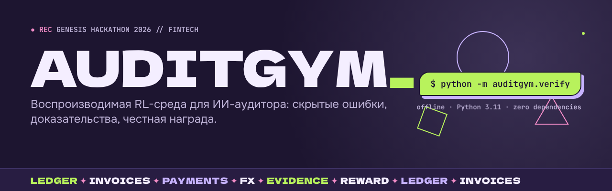

# AuditGym

**A reproducible RL environment and evaluator for financial-audit agents.** Synthetic company books with hidden, recorded errors; five read-only tools; a matcher and reward that pay for proof, not for persuasion. Genesis Hackathon 2026 · FinTech track.



## For the jury: 5 minutes

**One verification command** (offline, no GPU, no paid API, ~20 s):

```bash
docker build -t auditgym .
docker run --rm --network none auditgym            # = python -m auditgym.verify
```

Without Docker (Python 3.11, nothing to install):

```bash
PYTHONPATH=src python -m auditgym.verify           # Windows PowerShell: $env:PYTHONPATH="src"; python -m auditgym.verify
```

Expected output (abridged):

```
1 Contract & isolation         20/20 ✓✓✓✓✓✓✓✓✓✓✓✓✓✓✓✓✓✓✓✓
2 Data & reference             20/20 ✓✓✓✓✓✓✓✓✓✓✓✓✓✓✓✓✓✓✓✓
3 Reward reliability           20/20 ✓✓✓✓✓✓✓✓✓✓✓✓✓✓✓✓✓✓✓✓
4 Reproducibility              20/20 ✓✓✓✓✓✓✓✓✓✓✓✓✓✓✓✓✓✓✓✓
5 Engineering & explanation     5/5  ✓✓✓✓✓
Estimated score: 100.0 / 100
```

It writes `report.json` (versions, every check, diagnostics, failure analysis) and `trajectories.jsonl`, and exits non-zero on any failure. A pre-built `report.json` and `trajectories.jsonl` are committed in this repository.

Other entry points:

| Command | What it does |
|---|---|
| `python -m auditgym.cli demo` | one episode played by the reconciliation baseline, printed as text |
| `python -m auditgym.cli ui` | thin offline web UI on http://127.0.0.1:8000 (Play, Replay + Report) |
| `docker run --rm -p 8000:8000 auditgym ui --host 0.0.0.0 --no-browser` | the same UI from the image |
| `python -m auditgym.cli serve --stdio` | JSON-lines front door: `{"op":"reset","seed":1,"config":{}}`, `{"op":"step","action":{...}}`, `{"op":"state"}` |
| `python -m auditgym.cli serve --http --port 8080` | HTTP front door on 127.0.0.1: `POST /reset`, `POST /step`, `GET /state` |
| `python -m auditgym.cli evaluate --private DIR --findings FILE --steps N` | organizer scoring of one submission |
| `python -m auditgym.cli build-suite` | regenerate the 10 train + 10 dev episodes (golden hashes are tested) |
| `python -m unittest discover -s tests -q` | the test suite |

## The environment in one screen

```python
from auditgym.env.env import AuditEnv
env = AuditEnv(mode="open")                       # "closed": reward 0.0 until the run ends
obs, info = env.reset(seed=1, config={"interactions": ["A"]})
obs, reward, terminated, truncated, info = env.step(
    {"tool": "list_records", "args": {"table": "ledger", "cursor": None, "limit": 50}})
# tools: list_records, get_record, get_document, calculator, submit
```

- Episode = one fictional company, one reporting period, 200–2,000 ledger rows, 0–12 issues.
- Open files per episode (`episodes/<split>/<episode_id>/public/`): `manifest.json`, `ledger.csv`, `invoices.jsonl`, `payments.jsonl`, `fx.csv`, `policy.json`, `documents.jsonl`. Empty CSV cells are `null`.
- Evaluator-only files (`private/`): `truth.json`, `provenance.json` (replayable), `clean/` (books before injection).
- Four error types, two interaction scenarios, clean companies and legitimate distractors. Every rule, tolerance and the matching procedure are published in `policy.json`, the first observation and [DESIGN.md](DESIGN.md).

## Config

`reset(seed, config)` accepts any valid config; omitted keys take defaults; invalid ones return a bounded error. Keys: `n_invoices` (20–100), `n_expenses` (20–600), `errors` (per type 0–4), `clean`, `interactions` (`A`, `B`), `base_currency`, `foreign_currencies` (1–3), `foreign_share` (0.2–0.8), `timezone` (fixed-offset zones), `period_year`, `period_start_month`, `period_months` (1–3), `distractor_level` (0–2), `layout_seed`, `id_seed`, `config_version`. See `src/auditgym/config.py`.

## Repository

```
src/auditgym/   gen/ (history, injections, export, self-checks)  env/ (env, tools, calculator, front doors)
                eval/ (scoring, evaluator service, independent verifier)  policies/ (4 baselines, rules)
                ui/ (static, offline)  verify.py  cli.py
configs/        open train/dev seeds and configs        episodes/  10 train + 10 dev episodes
tests/          unit tests, the 5 rubric areas, golden hashes, independence of the verifier
```

## Кратко по-русски

AuditGym — воспроизводимая среда для обучения ИИ-аудиторов: синтетические книги вымышленных компаний со скрытыми записанными ошибками четырёх типов, пять инструментов только для чтения и награда за доказанные выводы. Одна команда проверки: `docker run --rm --network none auditgym`. Интерфейс: `python -m auditgym.cli ui`. Подробности, измеренный разбор сбоев и честные ограничения — в [DESIGN.md](DESIGN.md).

## License

MIT (see `LICENSE`). Bundled fonts: SIL Open Font License (`src/auditgym/ui/static/fonts/OFL-*.txt`). All data is synthetic: no real companies, people, bank records or payments.
