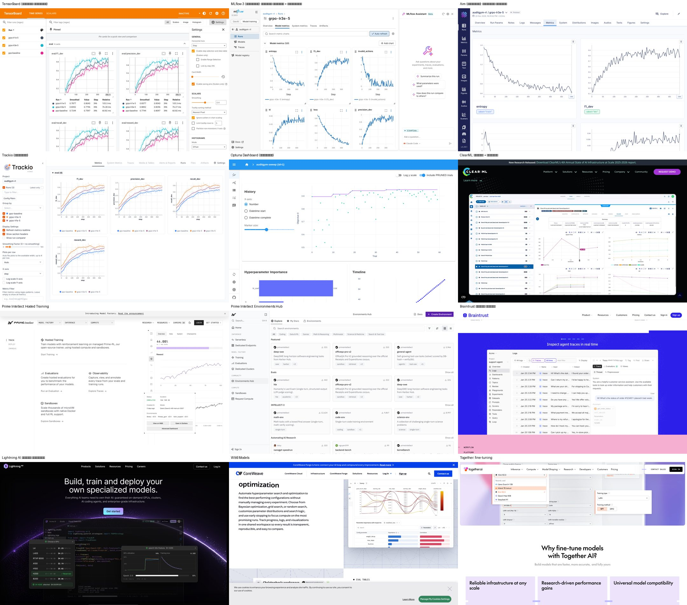
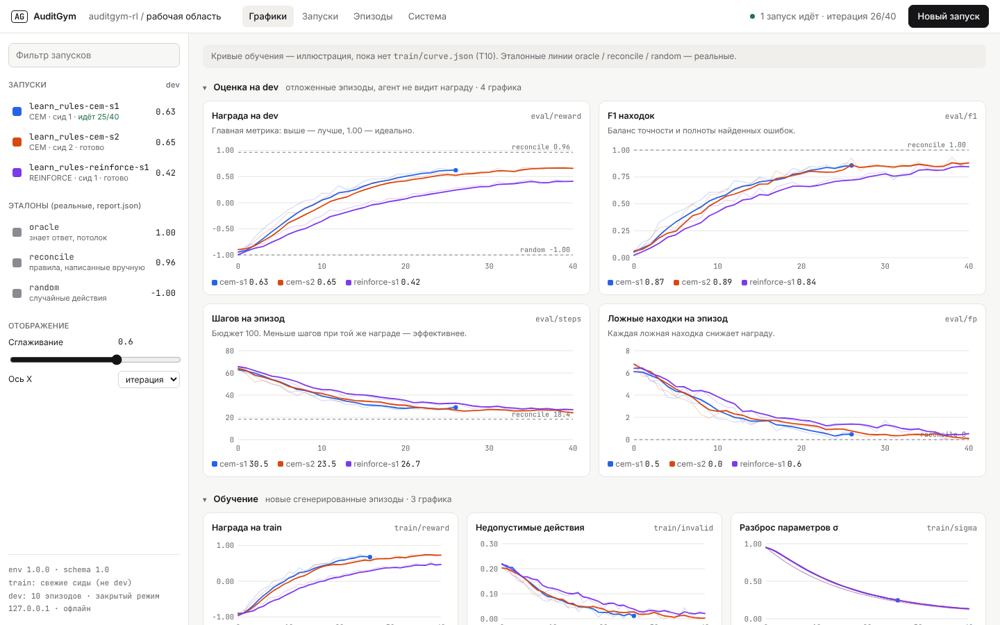
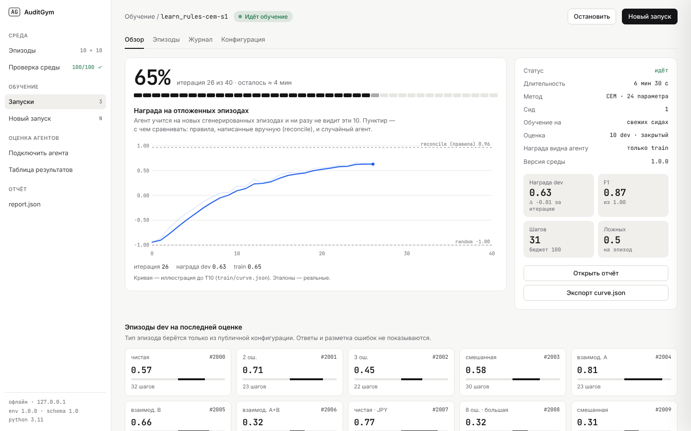
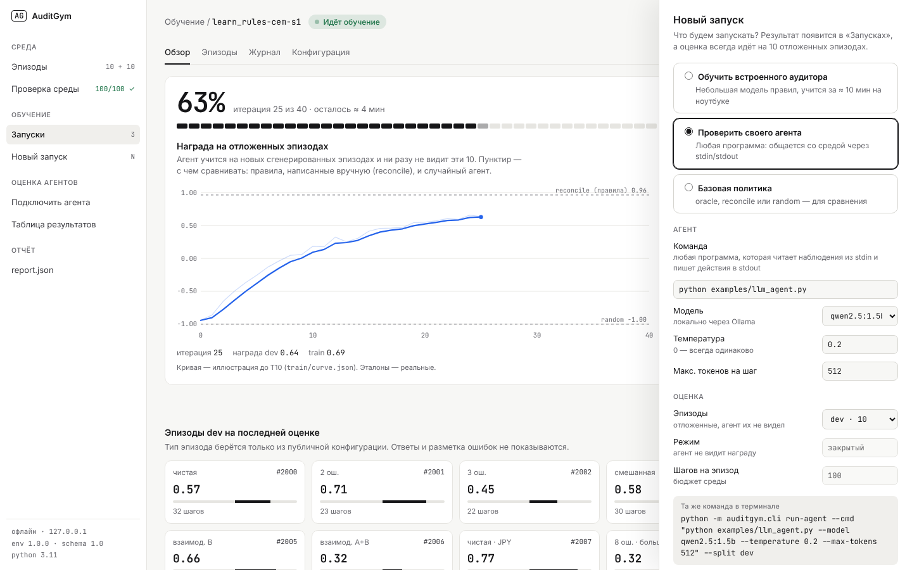
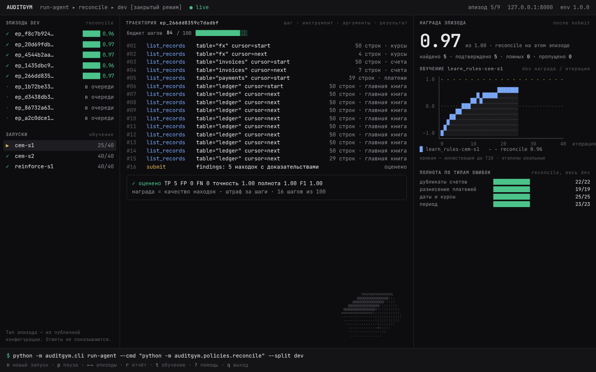
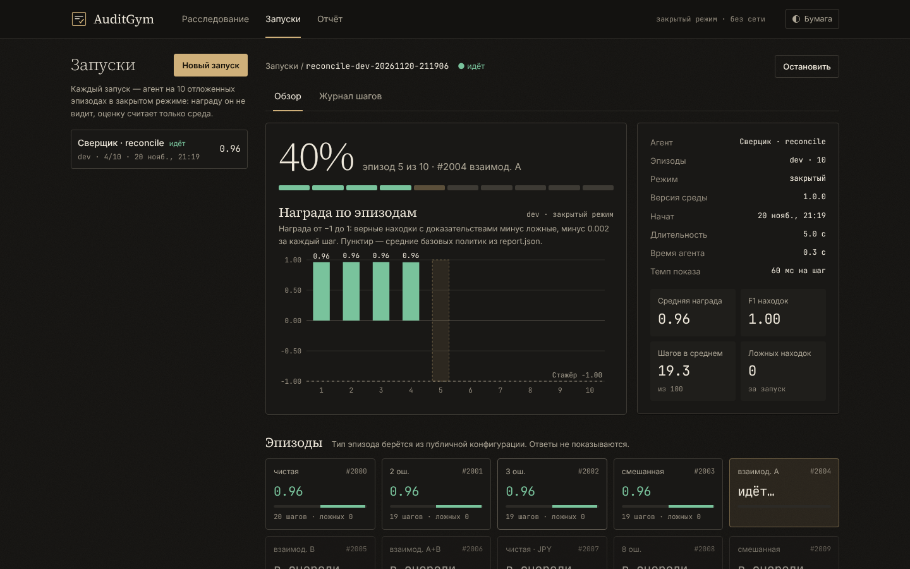
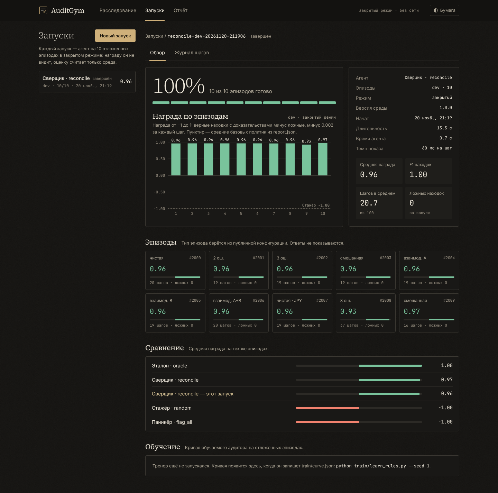
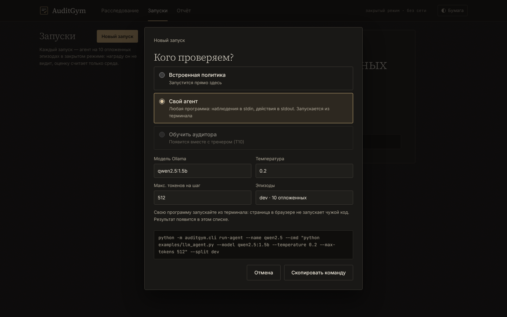
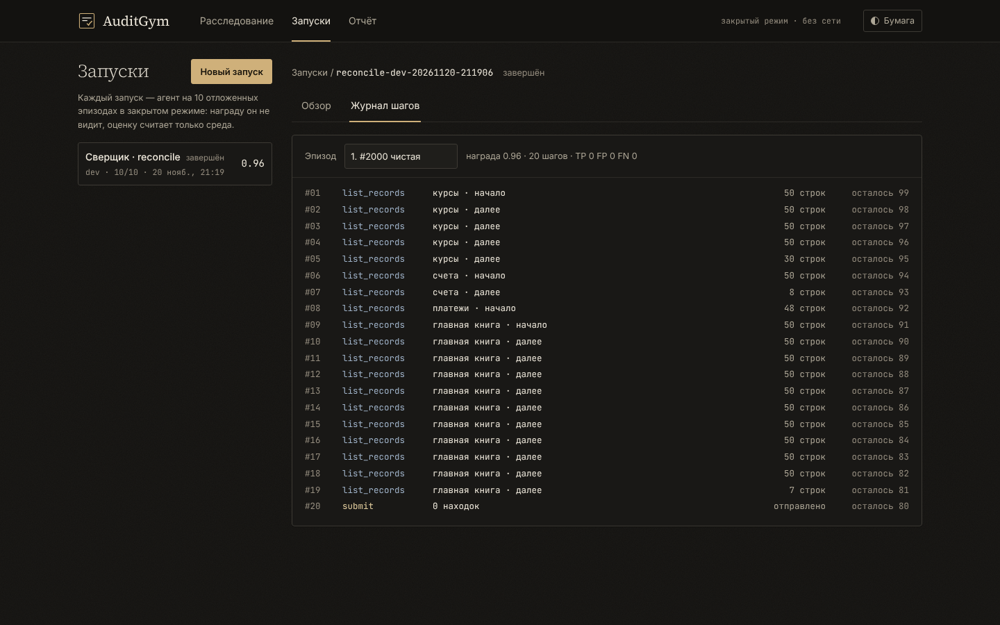
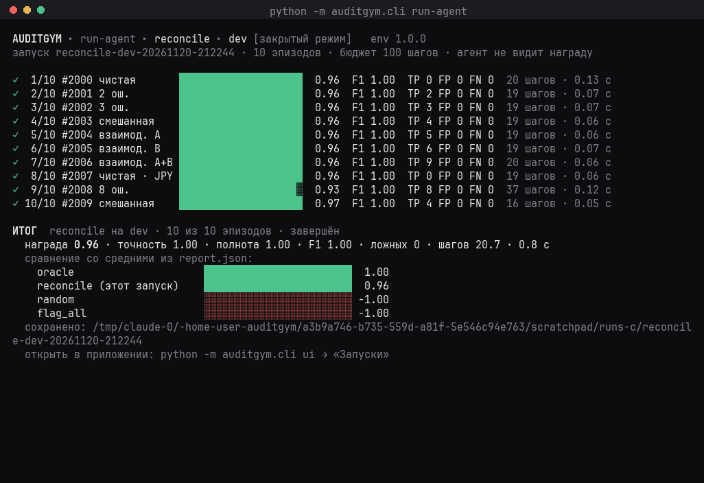

# AuditGym as a local training harness: market study and 3 layout options

Мади, Nov 20. The question: what should AuditGym look like as an app that **runs training and evaluation locally**,
not only a page to play one episode? Pick one of A, B, C below.

## What I looked at

- **Ran locally** with sample AuditGym-style runs (3 runs, 400 steps, dev and train metrics): TensorBoard 2.21,
  MLflow 3.18, Aim 3.29, Optuna Dashboard 0.21, Trackio 0.45. These are real UIs, not marketing images.
- **Product sites** (26): Weights & Biases (Models, Weave), Comet, ClearML, Neptune, MLflow, Trackio, Transformer Lab,
  Unsloth, LM Studio, Kiln, LLaMA-Factory, Ollama, OpenAI fine-tuning, HF AutoTrain, Together fine-tuning, Tinker,
  Prime Intellect (Hosted Training, Environments Hub), OpenPipe ART, Lightning AI, Braintrust, LangSmith, Langfuse,
  Arize Phoenix. Some sites failed: Comet 404, Neptune 502, Unsloth bot check, LM Studio did not load.
  Screenshots stay out of the repo; the contact sheet is `img/market-sheet.jpg`.



## Three layout families in this market

| Family | Who | Layout | Good at | Weak at |
|---|---|---|---|---|
| **Run workspace** | W&B, TensorBoard, MLflow, Aim, Trackio, ClearML, Comet | Left rail of runs (color swatch, checkbox, smoothing slider), main grid of metric panels in collapsible sections (eval / train), runs table, hover synced across charts | Comparing many runs, specialists | Wall of charts for a newcomer; nothing says "is this good?" |
| **Training console** | Prime Intellect Hosted Training, OpenAI / Together fine-tuning, Lightning, Tinker, AutoTrain | Left nav by task (Environments, Training, Evaluations), one run per page: status pill, big progress %, one large reward chart, status card (model, env, duration), "New run" form in a drawer or wizard | One clear story per run, newcomers, demos | Comparing runs is a separate page |
| **Trace explorer** | Braintrust, LangSmith, Langfuse, Weave, Phoenix | Three panes: list of traces, step-by-step tool calls, scores on the right | Seeing what the agent *did* (tool calls), debugging | Training curves are secondary |

Other things seen: MLflow 3 now puts an **AI assistant chat** on the right of runs (chat + charts hybrid).
Prime Intellect's **Environments Hub** is a card grid of RL environments, the closest product to AuditGym.
Every tracker keeps **eval and train in separate sections**, and shows **reference lines**.

## The 3 options (all use the same tokens, fonts and real AuditGym data)

Real data: baselines oracle 1.00 / reconcile 0.96 / random −1.00, the 16-step reconcile trajectory of
`ep_266dd8359c7dadbf` (TP 5, FP 0, reward 0.97), reconcile recall by error type, dev episode labels from the
public config. **Illustrative until T10:** the learning curves (`train/curve.json` does not exist yet).
`run-agent` (T12) commands are proposed, not implemented. Every page says this.

| | A · Workspace | B · Training console | C · Terminal trace |
|---|---|---|---|
| File | `option-a-workspace.html` | `option-b-console.html` (`#new` opens the form) | `option-c-terminal.html` |
| Inspired by | W&B, Trackio, TensorBoard | Prime Intellect, OpenAI fine-tuning, Lightning | Braintrust/LangSmith traces + btop, ASCII motion from v4 |
| Main screen | 7 charts: dev reward, F1, steps, false findings; train reward, invalid actions, σ | One run: 63 %, big dev reward chart vs reconcile and random, status card, 10 dev episode tiles, comparison bars | Episode queue, live tool-call stream with step budget, reward odometer, ASCII learning chart, recall bars |
| New run | button (not drawn) | drawer: built-in learner / your agent / baseline; model, temperature, max tokens; the same terminal command | `n` key, command line at the bottom |
| Motion | lines draw in, live run grows every 2.4 s, hover synced | progress segments, live curve, drawer slide | streamed steps, odometers, ASCII chart build-up, rotating ASCII ledger |
| For newcomers | weak | **strong**: plain-language captions | medium |
| For specialists | **strong** | medium | strong (and it *is* the terminal view) |
| For the jury demo | dense | **clear story** | **most memorable** |






## Rebuild

```bash
python3 -I docs/design-research/harness/tools/build_harness.py . docs/design-research/harness
node docs/design-research/harness/tools/shoot.js docs/design-research/harness /tmp/shots
```

## Decision (Мади, Nov 20): B for the app, C for the terminal — built

Both are real, not mock-ups, and share one harness (`src/auditgym/harness.py`, closed mode, runs saved to
`~/.auditgym/runs/`). Screenshots below are of the working app and a recorded terminal session, with real scores.

- **B → `/runs.html` ("Запуски")**, in the app's working-papers style: `python -m auditgym.cli ui`.
- **C → `python -m auditgym.cli run-agent --policy reconcile`** (or `--cmd "<your program>"`); video `img/built-c-terminal.mp4`.






