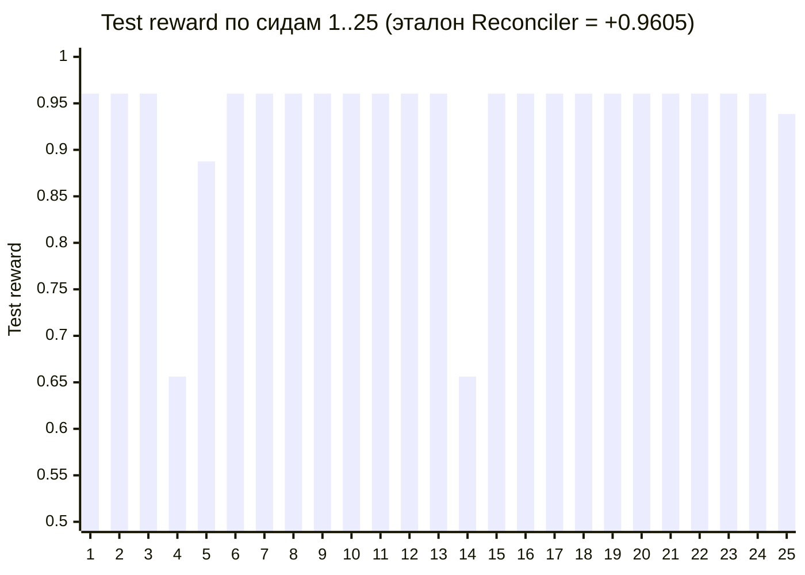

# Отчёт по 25 прогонам обучения AuditGym

> Независимая проверка обучения, сделанная участником команды (25 сидов, после исправления застревания в PR #12), и
> результаты тех же 25 сидов после следующего улучшения (PR #18, раздел 8). Обучение детерминировано: любой сид
> воспроизводится до четвёртого знака.

> [!IMPORTANT]
> **Итог:** Все **25 из 25** прогонов завершились успешно без единого застревания на «только дубликаты» (`0/25` провалов) и с **нулевым числом ложных срабатываний** (`Precision = 1.000` во всех 25 запусках). **21 из 25 (84%)** достигли абсолютного максимума **`+0.9605` (`F1 = 1.000`)**, вровень с эталонным `Reconciler`.

---

## 1. Конфигурация эксперимента

| Параметр | Значение |
|---|---|
| Репозиторий / коммит | `auditgym` · `main` (`5bd3104`; обучение то же, что в релизе `v0.2.3`), `ENV 1.0.0` |
| Метод | `CEM` (`method = "cem"`) |
| Датасет обучения | `Mixed` (`preset = "mixed"`) |
| Объём одного прогона | `30` итераций × `24` кандидата × `4` эпизода = **`2 880` эпизодов** (не пресет приложения: «Стандарт» — 30 × 16 × 4, «Глубоко» — 40 × 24 × 4) |
| Всего прогонов | **25** независимых сидов (`seed = 1..25`), всего **`72 000`** обучающих эпизодов |
| Тестовая выборка | `20` свежих эпизодов (`5` чистых, `10` с ошибками, `5` со взаимодействиями; `79` ошибок на тест) |
| Общее время (8 воркеров) | `290.3 с` (~4 мин 50 с) |

---

## 2. Агрегированная статистика (25 прогонов)

| Метрика | Среднее | Медиана | Стд. откл. | Минимум | Максимум | Эталон `Reconciler` | Случайный `Intern` |
|---|---:|---:|---:|---:|---:|---:|---:|
| **Test reward** | **`+0.9324`** | **`+0.9605`** | `0.0845` | `+0.6562` | `+0.9605` | `+0.9605` | `-1.0000` |
| **Test F1** | **`0.9856`** | **`1.0000`** | `0.0426` | `0.8467` | `1.0000` | `1.0000` | `0.0000` |
| **Test Precision** | **`1.0000`** | **`1.0000`** | `0.0000` | `1.0000` | `1.0000` | `1.0000` | `0.0000` |
| **Test Recall** | **`0.9747`** | **`1.0000`** | `0.0741` | `0.7342` | `1.0000` | `1.0000` | `0.0000` |
| **Ложных находок / эп.** | **`0.000`** | **`0.000`** | `0.000` | `0.000` | `0.000` | `0.000` | `2.850` |
| **Шагов / эп.** | `20.65` | `20.75` | `0.35` | `19.50` | `20.75` | `20.75` | `9.25` |
| **Dev start** | `-0.4669` | `-0.5590` | `0.2486` | `-0.6823` | `+0.3413` | — | — |
| **Dev best** | `+0.9373` | `+0.9606` | `0.0597` | `+0.7454` | `+0.9610` | — | — |
| **Итерация лучшего `dev`** | `20.3` | `20` | `5.7` | `6` | `29` | — | — |

### Распределение результатов по категориям
- **Идеально (`test = +0.9605`, `F1 = 1.000`, `79/79`):** **21 / 25 (84%)**
- **Почти идеально (`F1 >= 0.96`, `test >= +0.88`):** **2 / 25 (8%)** — сиды `5`, `25`
- **Частичная сходимость (3 из 4 типов ошибок, `test = +0.6562`, `F1 = 0.847`):** **2 / 25 (8%)** — сиды `4`, `14`
- **Провал / застревание на дубликатах (`test < 0.5`):** **0 / 25 (0%)**

---

## 3. График `Test reward` по всем 25 сидам

---

## 4. Суммарное покрытие по типам ошибок (25 прогонов × 20 тестовых эпизодов = 500 оценок)

| Тип ошибки | Найдено / Всего | Покрытие | Комментарий |
|---|---:|---:|---|
| `duplicate_invoice` (дубли счетов) | **350 / 350** | **100.0%** | Найдены во всех 25 прогонах |
| `period_classification` (период учёта) | **600 / 600** | **100.0%** | Найдены во всех 25 прогонах |
| `date_or_fx` (даты и курсы валют) | **492 / 500** | **98.4%** | Мелкие пропуски только на сидах `5` и `25` |
| `payment_allocation` (разноска платежей) | **483 / 525** | **92.0%** | Отключена таблица `payments` на сидах `4` и `14` |
| **Итого** | **1 925 / 1 975** | **97.5%** | **0 ложных срабатываний во всех 500 оценках** |

---

## 5. Полная таблица всех 25 прогонов

| Seed | Dev start | Dev best (iter) | Test reward | F1 | Precision | Recall | Steps | Duplicates | Payments | Date / FX | Periods |
|---:|---:|---:|---:|---:|---:|---:|---:|---:|---:|---:|---:|
| 1 | -0.6216 | +0.9606 (it 22) | **+0.9605** | 1.000 | 1.00 | 1.000 | 20.75 | 14/14 | 21/21 | 20/20 | 24/24 |
| 2 | -0.6008 | +0.9610 (it 26) | **+0.9605** | 1.000 | 1.00 | 1.000 | 20.75 | 14/14 | 21/21 | 20/20 | 24/24 |
| 3 | +0.3413 | +0.9610 (it 14) | **+0.9605** | 1.000 | 1.00 | 1.000 | 20.75 | 14/14 | 21/21 | 20/20 | 24/24 |
| 4 | -0.5574 | +0.7454 (it 18) | **+0.6562** | 0.847 | 1.00 | 0.734 | 19.50 | 14/14 | 0/21 | 20/20 | 24/24 |
| 5 | -0.3306 | +0.9073 (it 22) | **+0.8876** | 0.961 | 1.00 | 0.924 | 20.75 | 14/14 | 21/21 | 14/20 | 24/24 |
| 6 | -0.5574 | +0.9606 (it 22) | **+0.9605** | 1.000 | 1.00 | 1.000 | 20.75 | 14/14 | 21/21 | 20/20 | 24/24 |
| 7 | +0.0335 | +0.9608 (it 24) | **+0.9605** | 1.000 | 1.00 | 1.000 | 20.75 | 14/14 | 21/21 | 20/20 | 24/24 |
| 8 | -0.6012 | +0.9610 (it 14) | **+0.9605** | 1.000 | 1.00 | 1.000 | 20.75 | 14/14 | 21/21 | 20/20 | 24/24 |
| 9 | -0.5590 | +0.9606 (it 22) | **+0.9605** | 1.000 | 1.00 | 1.000 | 20.75 | 14/14 | 21/21 | 20/20 | 24/24 |
| 10 | -0.6046 | +0.9606 (it 18) | **+0.9605** | 1.000 | 1.00 | 1.000 | 20.75 | 14/14 | 21/21 | 20/20 | 24/24 |
| 11 | -0.6116 | +0.9606 (it 20) | **+0.9605** | 1.000 | 1.00 | 1.000 | 20.75 | 14/14 | 21/21 | 20/20 | 24/24 |
| 12 | -0.5590 | +0.9608 (it 14) | **+0.9605** | 1.000 | 1.00 | 1.000 | 20.75 | 14/14 | 21/21 | 20/20 | 24/24 |
| 13 | -0.0783 | +0.9606 (it 22) | **+0.9605** | 1.000 | 1.00 | 1.000 | 20.75 | 14/14 | 21/21 | 20/20 | 24/24 |
| 14 | -0.5574 | +0.7454 (it 6) | **+0.6562** | 0.847 | 1.00 | 0.734 | 19.50 | 14/14 | 0/21 | 20/20 | 24/24 |
| 15 | -0.6220 | +0.9606 (it 28) | **+0.9605** | 1.000 | 1.00 | 1.000 | 20.75 | 14/14 | 21/21 | 20/20 | 24/24 |
| 16 | -0.6004 | +0.9610 (it 28) | **+0.9605** | 1.000 | 1.00 | 1.000 | 20.75 | 14/14 | 21/21 | 20/20 | 24/24 |
| 17 | -0.5574 | +0.9606 (it 26) | **+0.9605** | 1.000 | 1.00 | 1.000 | 20.75 | 14/14 | 21/21 | 20/20 | 24/24 |
| 18 | -0.6807 | +0.9610 (it 20) | **+0.9605** | 1.000 | 1.00 | 1.000 | 20.75 | 14/14 | 21/21 | 20/20 | 24/24 |
| 19 | -0.5642 | +0.9606 (it 14) | **+0.9605** | 1.000 | 1.00 | 1.000 | 20.75 | 14/14 | 21/21 | 20/20 | 24/24 |
| 20 | -0.5744 | +0.9152 (it 28) | **+0.9605** | 1.000 | 1.00 | 1.000 | 20.75 | 14/14 | 21/21 | 20/20 | 24/24 |
| 21 | -0.1702 | +0.9610 (it 18) | **+0.9605** | 1.000 | 1.00 | 1.000 | 20.75 | 14/14 | 21/21 | 20/20 | 24/24 |
| 22 | -0.4026 | +0.9606 (it 18) | **+0.9605** | 1.000 | 1.00 | 1.000 | 20.75 | 14/14 | 21/21 | 20/20 | 24/24 |
| 23 | -0.3946 | +0.9606 (it 20) | **+0.9605** | 1.000 | 1.00 | 1.000 | 20.75 | 14/14 | 21/21 | 20/20 | 24/24 |
| 24 | -0.6823 | +0.9320 (it 29) | **+0.9605** | 1.000 | 1.00 | 1.000 | 20.75 | 14/14 | 21/21 | 20/20 | 24/24 |
| 25 | -0.5590 | +0.9320 (it 14) | **+0.9385** | 0.987 | 1.00 | 0.975 | 20.75 | 14/14 | 21/21 | 18/20 | 24/24 |

---

## 6. Разбор 4 неидеальных сидов

1. **Сиды `5` (`+0.8876`, `F1 = 0.961`) и `25` (`+0.9385`, `F1 = 0.987`):**
   - Все таблицы и все 4 проверки включены (`off_rules = []`).
   - Единственные пропуски — в `date_or_fx` (`14/20` и `18/20`). Гипотеза (не измерялась отдельно): непрерывный параметр `fx_tolerance` (или `min_amount`) остановился чуть выше порога самых мелких курсовых расхождений. На чистых и взаимодействующих эпизодах — почти максимум (`clean: +0.962`, `interacting: +0.9564`).
2. **Сиды `4` и `14` (`+0.6562`, `F1 = 0.847`):**
   - Идеально освоены **3 из 4** проверок (`duplicates 14/14`, `date_or_fx 20/20`, `periods 24/24`, `clean: +0.9644`).
   - Остались выключены параметры `read_payments` / `pages_payments` (на сиде `14` также `check_payment`, `payment_strict`), поэтому `payment_allocation` = `0/21`.
   - Причина: на `30` итерациях поиск успел выйти на сильное плато `+0.745` (на 3 типах ошибок), но не успел дожать одновременное включение пары `read_payments + payment_strict` (на `40` итерациях, т.е. пресете `Deep`, такие сиды обычно дожимаются).

---

## 7. Вывод

Исправление застревания (PR #12, `task/learner-escape` в `src/auditgym/learner.py`, вошло в `v0.2.1`–`v0.2.3`) кардинально стабилизировало обучение:
- **До обновления:** даже на дефолтном `seed 1` (`population 24 × 4`) случался коллапс в `-0.13` (`14/79` ошибок).
- **После обновления:** медиана по 25 сидам — **идеальные `+0.9605` (`F1 = 1.000`)**, среднее **`+0.9324` (`F1 = 0.986`)**, **0 провалов** и **0 ложных срабатываний** во всех 500 оценках.

---

## 8. После следующего улучшения (PR #18): те же 25 сидов

Разбор сидов `4` и `14` показал причину: у лучшего кандидата проверка разноски была включена, но таблица платежей не
читалась, а включить её можно только **всей группой настроек сразу** (читать платежи, достаточно страниц, проверка,
строгость разноски). Расширение поиска вокруг уже решённого среднего такую комбинацию почти никогда не пробует.

**Что изменено** (`src/auditgym/learner.py`, только CEM, только награда на обучении — dev в поиск не попадает): после
плато в следующую популяцию добавляются копии лучшего кандидата, в которых одна неработающая проверка включена
целиком, а её режим пробуется в обе стороны. Они оцениваются как любой кандидат; если лучше — побеждают обычным
отбором. Проверка считается работающей, только если включены все её настройки.

| Метрика (25 сидов, 30 × 24 × 4) | Раздел 2 (до) | После PR #18 |
|---|---:|---:|
| Средняя награда на тесте | `+0.9324` | **`+0.9590`** |
| Минимум | `+0.6562` | **`+0.9385`** |
| Идеально (`+0.9605`, 79/79) | 21 / 25 | **23 / 25** |
| Хотя бы одна проверка не освоена | 2 / 25 (сиды 4, 14) | **0 / 25** |

Оставшиеся два сида (`5`, `25`) пропускают 1–2 мелких курсовых расхождения из 20. На пресете «Стандарт»
(30 × 16 × 4, сиды 1–12) среднее выросло с `+0.92` до `+0.948`; контроль с шумом вместо награды по-прежнему намного
ниже (сид 1: запас `+0.95` на dev и `+1.09` на тесте).

| Seed | Test reward | Duplicates | Payments | Date / FX | Periods |
|---:|---:|---:|---:|---:|---:|
| 1 | +0.9605 | 14/14 | 21/21 | 20/20 | 24/24 |
| 2 | +0.9605 | 14/14 | 21/21 | 20/20 | 24/24 |
| 3 | +0.9605 | 14/14 | 21/21 | 20/20 | 24/24 |
| 4 | +0.9605 | 14/14 | 21/21 | 20/20 | 24/24 |
| 5 | **+0.9462** | 14/14 | 21/21 | 19/20 | 24/24 |
| 6 | +0.9605 | 14/14 | 21/21 | 20/20 | 24/24 |
| 7 | +0.9605 | 14/14 | 21/21 | 20/20 | 24/24 |
| 8 | +0.9605 | 14/14 | 21/21 | 20/20 | 24/24 |
| 9 | +0.9605 | 14/14 | 21/21 | 20/20 | 24/24 |
| 10 | +0.9605 | 14/14 | 21/21 | 20/20 | 24/24 |
| 11 | +0.9605 | 14/14 | 21/21 | 20/20 | 24/24 |
| 12 | +0.9605 | 14/14 | 21/21 | 20/20 | 24/24 |
| 13 | +0.9605 | 14/14 | 21/21 | 20/20 | 24/24 |
| 14 | +0.9605 | 14/14 | 21/21 | 20/20 | 24/24 |
| 15 | +0.9605 | 14/14 | 21/21 | 20/20 | 24/24 |
| 16 | +0.9605 | 14/14 | 21/21 | 20/20 | 24/24 |
| 17 | +0.9605 | 14/14 | 21/21 | 20/20 | 24/24 |
| 18 | +0.9605 | 14/14 | 21/21 | 20/20 | 24/24 |
| 19 | +0.9605 | 14/14 | 21/21 | 20/20 | 24/24 |
| 20 | +0.9605 | 14/14 | 21/21 | 20/20 | 24/24 |
| 21 | +0.9605 | 14/14 | 21/21 | 20/20 | 24/24 |
| 22 | +0.9605 | 14/14 | 21/21 | 20/20 | 24/24 |
| 23 | +0.9605 | 14/14 | 21/21 | 20/20 | 24/24 |
| 24 | +0.9605 | 14/14 | 21/21 | 20/20 | 24/24 |
| 25 | **+0.9385** | 14/14 | 21/21 | 18/20 | 24/24 |
