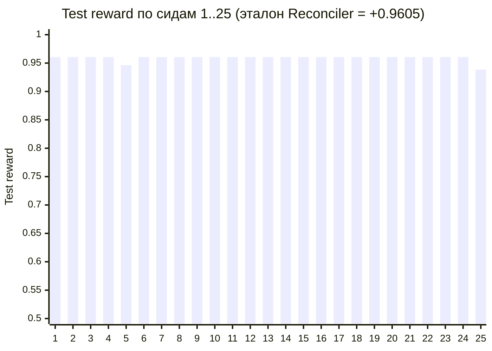

# Отчёт по 25 прогонам AuditGym (`v0.2.4`)

> Первую проверку на этих 25 сидах (`v0.2.3`) провёл участник команды; она нашла два прогона, где проверка разноски
> так и не освоилась, и это привело к улучшению обучения (PR #18). Здесь — те же сиды и та же конфигурация,
> заново измеренные на `v0.2.4`; числа `v0.2.3` — в разделе 7.

> [!IMPORTANT]
> **Итог:** все **25 из 25** прогонов освоили **все 4 типа ошибок** (`0/25` застреваний) при **нулевом числе ложных срабатываний** (`Precision = 1.000` во всех 25 запусках). **23 из 25 (92%)** достигли максимума **`+0.9605` (`F1 = 1.000`)**, вровень с эталонным `Reconciler`. Худший прогон — **`+0.9385`** (в `v0.2.3`: `+0.6562`).

---

## 1. Конфигурация эксперимента

| Параметр | Значение |
|---|---|
| Репозиторий / коммит | `auditgym` · `main` (`849ec04`; обучение то же, что в релизе `v0.2.4`), `ENV 1.0.0` |
| Метод | `CEM` (`method = "cem"`) |
| Датасет обучения | `Mixed` (`preset = "mixed"`) |
| Объём одного прогона | `30` итераций × `24` кандидата × `4` эпизода = **`2 880` эпизодов** (не пресет приложения: «Стандарт» — 30 × 16 × 4, «Глубоко» — 40 × 24 × 4) |
| Всего прогонов | **25** независимых сидов (`seed = 1..25`), всего **`72 000`** обучающих эпизодов |
| Тестовая выборка | `20` свежих эпизодов (`5` чистых, `10` с ошибками, `5` со взаимодействиями; `79` ошибок на тест) |
| Общее время (4 воркера) | `224 с` (~4 мин) |

---

## 2. Агрегированная статистика (25 прогонов)

| Метрика | Среднее | Медиана | Стд. откл. | Минимум | Максимум | Эталон `Reconciler` | Случайный `Intern` |
|---|---:|---:|---:|---:|---:|---:|---:|
| **Test reward** | **`+0.9590`** | **`+0.9605`** | `0.0050` | `+0.9385` | `+0.9605` | `+0.9605` | `-1.0000` |
| **Test F1** | **`0.9992`** | **`1.0000`** | `0.0028` | `0.9872` | `1.0000` | `1.0000` | `0.0000` |
| **Test Precision** | **`1.0000`** | **`1.0000`** | `0.0000` | `1.0000` | `1.0000` | `1.0000` | `0.0000` |
| **Test Recall** | **`0.9985`** | **`1.0000`** | `0.0055` | `0.9747` | `1.0000` | `1.0000` | `0.0000` |
| **Ложных находок / эп.** | **`0.000`** | **`0.000`** | `0.0000` | `0.000` | `0.000` | `0.000` | `2.850` |
| Шагов / эп. | `20.75` | `20.75` | `0.00` | `20.75` | `20.75` | `20.75` | `9.25` |
| **Dev start** | `-0.4669` | `-0.5590` | `0.2436` | `-0.6823` | `+0.3413` | — | — |
| **Dev best** | `+0.9573` | `+0.9606` | `0.0093` | `+0.9320` | `+0.9610` | — | — |
| **Итерация лучшего `dev`** | `18.2` | `20` | `5.5` | `8` | `26` | — | — |

### Распределение результатов по категориям
- **Идеально (`test = +0.9605`, `F1 = 1.000`, `79/79`):** **23 / 25 (92%)**
- **Почти идеально (`test >= +0.88`):** **2 / 25 (8%)** — сиды `5`, `25`
- **Частичная сходимость (одна проверка не освоена):** **0 / 25**
- **Провал / застревание на дубликатах (`test < 0.5`):** **0 / 25**

---

## 3. График `Test reward` по всем 25 сидам

---

## 4. Суммарное покрытие по типам ошибок (25 прогонов × 20 тестовых эпизодов = 500 оценок)

| Тип ошибки | Найдено / Всего | Покрытие | Комментарий |
|---|---:|---:|---|
| `duplicate_invoice` (дубли счетов) | **350 / 350** | **100.0%** | Найдены во всех 25 прогонах |
| `period_classification` (период учёта) | **600 / 600** | **100.0%** | Найдены во всех 25 прогонах |
| `date_or_fx` (даты и курсы валют) | **497 / 500** | **99.4%** | Мелкие пропуски только на сидах `5`, `25` |
| `payment_allocation` (разноска платежей) | **525 / 525** | **100.0%** | Освоена во всех 25 прогонах (в `v0.2.3`: `483 / 525`) |
| **Итого** | **1972 / 1975** | **99.8%** | **0 ложных срабатываний во всех 500 оценках** |

---

## 5. Полная таблица всех 25 прогонов

| Seed | Dev start | Dev best (iter) | Test reward | F1 | Precision | Recall | Steps | Duplicates | Payments | Date / FX | Periods |
|---:|---:|---:|---:|---:|---:|---:|---:|---:|---:|---:|---:|
| 1 | -0.6216 | +0.9606 (it 22) | **+0.9605** | 1.000 | 1.00 | 1.000 | 20.75 | 14/14 | 21/21 | 20/20 | 24/24 |
| 2 | -0.6008 | +0.9610 (it 24) | **+0.9605** | 1.000 | 1.00 | 1.000 | 20.75 | 14/14 | 21/21 | 20/20 | 24/24 |
| 3 | +0.3413 | +0.9610 (it 20) | **+0.9605** | 1.000 | 1.00 | 1.000 | 20.75 | 14/14 | 21/21 | 20/20 | 24/24 |
| 4 | -0.5574 | +0.9608 (it 24) | **+0.9605** | 1.000 | 1.00 | 1.000 | 20.75 | 14/14 | 21/21 | 20/20 | 24/24 |
| 5 | -0.3306 | +0.9324 (it 24) | **+0.9462** | 0.994 | 1.00 | 0.987 | 20.75 | 14/14 | 21/21 | 19/20 | 24/24 |
| 6 | -0.5574 | +0.9608 (it 10) | **+0.9605** | 1.000 | 1.00 | 1.000 | 20.75 | 14/14 | 21/21 | 20/20 | 24/24 |
| 7 | +0.0335 | +0.9608 (it 22) | **+0.9605** | 1.000 | 1.00 | 1.000 | 20.75 | 14/14 | 21/21 | 20/20 | 24/24 |
| 8 | -0.6012 | +0.9608 (it 14) | **+0.9605** | 1.000 | 1.00 | 1.000 | 20.75 | 14/14 | 21/21 | 20/20 | 24/24 |
| 9 | -0.5590 | +0.9606 (it 22) | **+0.9605** | 1.000 | 1.00 | 1.000 | 20.75 | 14/14 | 21/21 | 20/20 | 24/24 |
| 10 | -0.6046 | +0.9606 (it 14) | **+0.9605** | 1.000 | 1.00 | 1.000 | 20.75 | 14/14 | 21/21 | 20/20 | 24/24 |
| 11 | -0.6116 | +0.9606 (it 16) | **+0.9605** | 1.000 | 1.00 | 1.000 | 20.75 | 14/14 | 21/21 | 20/20 | 24/24 |
| 12 | -0.5590 | +0.9610 (it 12) | **+0.9605** | 1.000 | 1.00 | 1.000 | 20.75 | 14/14 | 21/21 | 20/20 | 24/24 |
| 13 | -0.0783 | +0.9608 (it 26) | **+0.9605** | 1.000 | 1.00 | 1.000 | 20.75 | 14/14 | 21/21 | 20/20 | 24/24 |
| 14 | -0.5574 | +0.9608 (it 26) | **+0.9605** | 1.000 | 1.00 | 1.000 | 20.75 | 14/14 | 21/21 | 20/20 | 24/24 |
| 15 | -0.6220 | +0.9606 (it 24) | **+0.9605** | 1.000 | 1.00 | 1.000 | 20.75 | 14/14 | 21/21 | 20/20 | 24/24 |
| 16 | -0.6004 | +0.9610 (it 22) | **+0.9605** | 1.000 | 1.00 | 1.000 | 20.75 | 14/14 | 21/21 | 20/20 | 24/24 |
| 17 | -0.5574 | +0.9606 (it 18) | **+0.9605** | 1.000 | 1.00 | 1.000 | 20.75 | 14/14 | 21/21 | 20/20 | 24/24 |
| 18 | -0.6807 | +0.9606 (it 18) | **+0.9605** | 1.000 | 1.00 | 1.000 | 20.75 | 14/14 | 21/21 | 20/20 | 24/24 |
| 19 | -0.5642 | +0.9322 (it 10) | **+0.9605** | 1.000 | 1.00 | 1.000 | 20.75 | 14/14 | 21/21 | 20/20 | 24/24 |
| 20 | -0.5744 | +0.9606 (it 22) | **+0.9605** | 1.000 | 1.00 | 1.000 | 20.75 | 14/14 | 21/21 | 20/20 | 24/24 |
| 21 | -0.1702 | +0.9610 (it 8) | **+0.9605** | 1.000 | 1.00 | 1.000 | 20.75 | 14/14 | 21/21 | 20/20 | 24/24 |
| 22 | -0.4026 | +0.9606 (it 14) | **+0.9605** | 1.000 | 1.00 | 1.000 | 20.75 | 14/14 | 21/21 | 20/20 | 24/24 |
| 23 | -0.3946 | +0.9606 (it 20) | **+0.9605** | 1.000 | 1.00 | 1.000 | 20.75 | 14/14 | 21/21 | 20/20 | 24/24 |
| 24 | -0.6823 | +0.9606 (it 10) | **+0.9605** | 1.000 | 1.00 | 1.000 | 20.75 | 14/14 | 21/21 | 20/20 | 24/24 |
| 25 | -0.5590 | +0.9320 (it 14) | **+0.9385** | 0.987 | 1.00 | 0.975 | 20.75 | 14/14 | 21/21 | 18/20 | 24/24 |

---

## 6. Разбор неидеальных сидов

- **Сид `5` (`+0.9462`, `F1 = 0.994`):** все 4 проверки освоены, ложных находок нет; пропуски — `date_or_fx` `19/20`. Гипотеза (отдельно не измерялась): непрерывный допуск по курсу (`fx_tolerance`) остановился чуть выше порога самых мелких курсовых расхождений.
- **Сид `25` (`+0.9385`, `F1 = 0.987`):** все 4 проверки освоены, ложных находок нет; пропуски — `date_or_fx` `18/20`. Гипотеза (отдельно не измерялась): непрерывный допуск по курсу (`fx_tolerance`) остановился чуть выше порога самых мелких курсовых расхождений.

Сиды `4` и `14`, которые в `v0.2.3` застревали на `+0.6562` (`payments 0/21`), теперь дают **`+0.9605`** и **`+0.9605`**: на плато в популяцию добавляется лучший кандидат с целиком включённой неработающей проверкой (PR #18), и он побеждает обычным отбором. Улучшение использует только награду на обучающих эпизодах; отложенный `dev` в поиск не попадает.

---

## 7. Вывод: `v0.2.3` → `v0.2.4`

| Метрика (те же 25 сидов, 30 × 24 × 4) | `v0.2.3` | `v0.2.4` |
|---|---:|---:|
| Средняя награда на тесте | `+0.9324` | **`+0.9590`** |
| Медиана | `+0.9605` | **`+0.9605`** |
| Минимум | `+0.6562` | **`+0.9385`** |
| Средний F1 | `0.9856` | **`0.9992`** |
| Средний Recall | `0.9747` | **`0.9985`** |
| Precision | `1.0000` | **`1.0000`** |
| Идеально (`+0.9605`) | 21 / 25 | **23 / 25** |
| Хотя бы одна проверка не освоена | 2 / 25 | **0 / 25** |
| Найдено ошибок за 500 оценок | 1 925 / 1 975 (97.5%) | **1972 / 1975 (99.8%)** |

Контроль с шумом вместо награды по-прежнему намного ниже (`train/campaign.py`, сид 1: лучший dev `+0.009`, тест `-0.131` против `+0.961` с наградой), так что прирост даёт именно награда. Обучение детерминировано: любой сид воспроизводится до четвёртого знака.
